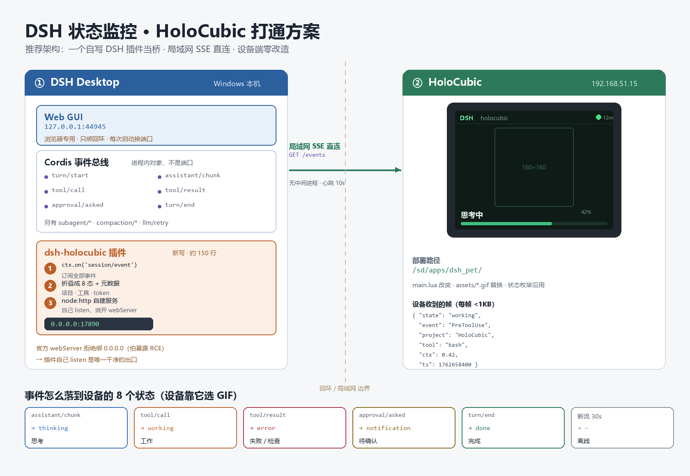
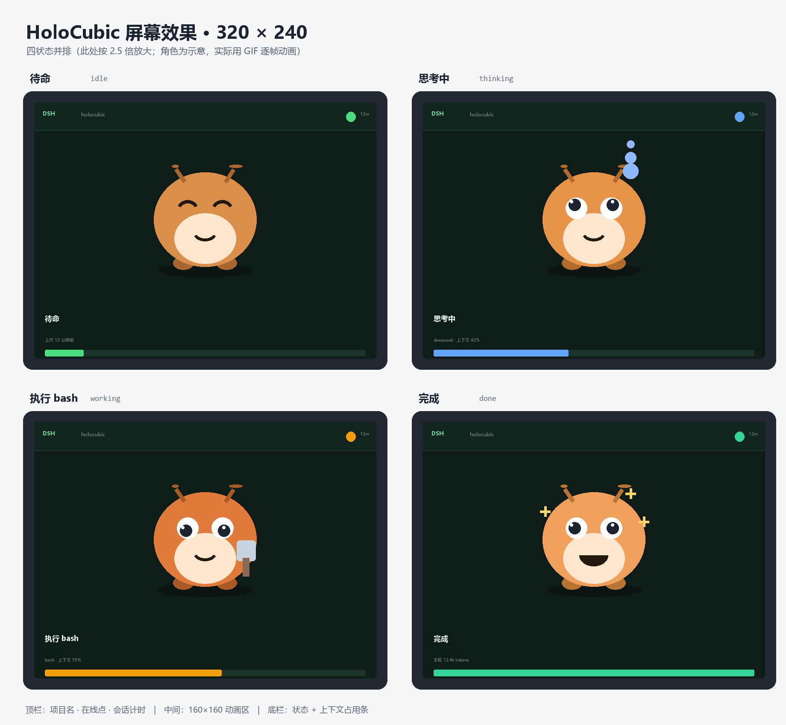

<div align="center">


# HoloPet

**把 DeepSeek Harness 的工作状态，投到一台 320×240 的桌搭屏上。**

[](LICENSE)
[](CREDITS.md)
[](https://github.com/MadLongTom/holopet)

</div>

---

## 这是什么

DSH（DeepSeek Harness）在电脑上跑任务时，你不会一直盯着屏幕看。HoloPet 把它的实时状态——**在想什么、在跑什么命令、上下文用了多少、这个月花了多少钱**——变成一台巴掌大的透明小屏上的角色动画。

角色会：

- 空闲时左右走动、东张西望、哼歌、照镜子
- 你发指令时抬头听、挥手回应
- 执行工具时敲键盘、写代码、轻快记录
- 等你确认时原地踱步、期待地望着你
- 出错时垂头叹气冒汗
- 完成时雀跃庆祝、放烟花、比心



## 两个界面

<table>
<tr>
<td width="50%">

**A 页 · 角色为主**

整屏就是一个角色。顶栏是状态名和时钟，底栏是当前项目、本轮的计时、上下文进度条和余额。状态色会跟着事件变化——待命绿、思考蓝、执行橙、出错红。

</td>
<td width="50%">

**B 页 · 场景化终端**

上半屏是一个终端窗，显示最近执行过的命令流；左下角是角色（跟着当前事件换动作）；右侧是上下文占用、token 六项细分（本轮 / 总计 / 未缓存输入 / 输出 / 缓存读取 / 命中率），最下面是**峰谷时段刻度条**，黄段是峰价时段，箭头实时指示当前时刻。

</td>
</tr>
</table>



左右倾斜设备（或按键）切换界面。

## 架构

```
┌─────────────────────────┐         ┌──────────────────────────┐
│  DSH Desktop (Windows)  │         │  HoloCubic (192.168.x.x) │
│                         │         │                          │
│  Cordis 事件总线        │         │  app/main.lua            │
│        │                │         │    ├─ A 页（角色）        │
│        ▼                │   SSE   │    ├─ B 页（终端）        │
│  dsh-pet-holocubic 插件 │ ──────▶ │    └─ 配置页 /dsh_fish/  │
│  0.0.0.0:17890          │  局域网  │                          │
│  GET /state  GET /events│         │  皮肤 / 动作 / 音效       │
└─────────────────────────┘         └──────────────────────────┘
```

- **插件**订阅 DSH 的 `session/event` 总线，把事件折叠成 8 种状态，通过 `0.0.0.0:17890` 的 HTTP + SSE 推给设备
- **设备端**是一个 HoloCubic Lua 应用，用 `net` 裸 TCP 订阅 SSE，按事件选择动作组播放 GIF

没有中间进程、没有桥接服务。**只要 DSH 在跑，设备就能看到状态。**

## 快速开始

### 前置条件

- 一台 HoloCubic 桌搭屏（320×240，透明屏更好），能连局域网
- 电脑上装着 DSH Desktop
- 两者在同一网段

### 1. 安装 DSH 插件

把 `plugin/dsh-pet-holocubic/` 整个目录复制到你的 DSH profile 的 `node_modules/` 下：

```bash
cp -r plugin/dsh-pet-holocubic ~/.dsh/profiles/desktop/node_modules/
```

然后在 profile 的 `package.json` 里，把包名加进 `dsh.profile.bundles` 数组：

```json
"bundles": [
  "...",
  "dsh-pet-holocubic"
]
```

**重启 DSH Desktop**。重启后插件会监听 `0.0.0.0:17890`。

验证：

```bash
curl http://127.0.0.1:17890/state
```

应该返回一大段 JSON，含 `state`、`project`、`tool`、`balance`、`peak` 等字段。

> **端口被占怎么办**：插件会依次尝试 17891–17895。但设备端固定连 17890，所以请确保 17890 空闲（用 `netstat -ano | findstr 17890` 查）。

### 2. 把应用装到设备

两种方式：

**方式一：用脚本（推荐）**

```bash
python tools/deploy_app.py
```

脚本会把 `app/` 目录下所有文件通过 `/devtools/api` 上传到设备的 `/sd/apps/dsh_fish/`。

**方式二：手动**

打开设备的开发工具页 `http://<设备IP>/devtools/`，把 `app/` 目录里的文件逐个上传到 `/sd/apps/dsh_fish/`。

> 上传后如果启动器里看不到应用，在开发工具页执行一次「运行」任意代码触发重扫。

### 3. 配置连接

设备上打开 HoloPet → 配置页 → 「主机连接」：

- **主机 IP**：填运行 DSH 那台电脑的**局域网 IP**（不是 127.0.0.1）
- **端口**：17890
- **事件路径**：`/events`

点「保存并重连」，「连接状态」里应该变成 🟢 **已连接**。

> 电脑 IP 怎么查：`ipconfig`，找 WLAN 那一段的 IPv4 地址。
>
> **连不上先查防火墙**：Windows 防火墙默认会拦入站。放行 17890 端口，或临时关掉防火墙测试。

## 皮肤与动作

内置两套皮肤：

| 皮肤 | 来源 | 动作数 | 许可 |
|---|---|---|---|
| **蓝毛小女仆**（默认） | [PC2005-cloud/dsh-pet](https://github.com/PC2005-cloud/dsh-pet) | 114 个动作 | CC BY-NC-SA 4.0 |
| **鲸鱼娘** | [zhu1090093659/dsh-pet](https://github.com/zhu1090093659/dsh-pet) | 16 个动作 | BSD-3 |

每个皮肤有三档动画速度（慢 150ms / 标准 120ms / 快 90ms 每帧）。

### 动作变体系统

一个事件可以挂多个动作，按顺序轮播。比如「待机」挂了 8 个动作（待机呼吸、东张西望、悠闲哼歌、照镜子、吃白饭…），空闲时会轮着播。

配置页「行为」里可以：

- 每个事件下逐一勾选启用哪些动作（点「全部」可展开皮肤包里所有 114 个动作跨组挑选）
- 标记哪些动作「可走动」——勾了的动作只在移动时播放
- 给每个事件配一个音效（30 个内置音效，分 soft / crystal / retro / nature 四组）
- 调走动节奏：停顿频率、停顿时长
- 单独设置三个位移动画的平移速度

### 皮肤包格式

一个皮肤是一个目录：

```
assets/skins/<皮肤id>/
├── manifest.lua          # 事件→动作映射、分类、标签
├── slow/                 # 慢速档 GIF
├── normal/               # 标准档
├── fast/                 # 快速档
└── mute/normal/          # 88×88 缩略图（B 页用）
```

`manifest.lua` 大致长这样：

```lua
return {
  id = "pc2005",
  name = "蓝毛小女仆",
  speeds = { slow = 150, normal = 120, fast = 90 },
  events = {
    Idle = { "daiji-huxi-xiuxian.gif", "dongzhangxiwang.gif", ... },
    PreToolUse = { "manglu-dianan.gif", "xiedaima.gif", ... },
    ...
  },
  categories = {
    { id = "待机", files = { "daiji-huxi-xiuxian.gif" } },
    ...
  },
  labels = { ["daiji-huxi-xiuxian.gif"] = "待机呼吸休闲", ... },
  moves = {
    { file = "ceshen-jizao-pao.gif", lead = 0.6, tail = 0.6, facing = "left", speed = 5 },
    ...
  },
}
```

做新皮肤可以用 `tools/skin_studio.py`（GUI 工作台：选精灵表 → 标行列 → 生成三档 GIF + manifest）。

## 配置页能调什么

设备上访问 `http://<设备IP>/dsh_fish/`：

- **主机连接** — IP / 端口 / 路径 / 语言 / 音量
- **连接状态** — 实时连接指示、设备字体信息
- **显示项** — A/B 两页各 8 个元素，取消勾选即隐藏
- **皮肤与动画** — 换皮肤、换速度档、隐藏皮肤、全部动作预览（按官方 15 类分组）
- **外观配色** — 8 种颜色（背景 / 面板 / 进度条底色 / 主文字 / 次要文字 / 强调色 / 警示色 / 错误色）+ 字号倍率 + 音量
- **行为** — 事件→动作变体、可走动标记、音效、走动节奏、位移动画速度、峰谷提示音

配色区有一张对照图，标出每个颜色管屏幕的哪块区域。

> 配色和字号改完需要**重启应用**才生效（LVGL 样式在控件创建时固化）；音量、皮肤、动作、音效是**即时生效**。

## 数据口径

- **上下文占用**：插件上报最近一次请求的 `input + cacheRead + cacheWrite`，除以模型窗口（`deepseek-v4.1-flash` 是 1,000,000）
- **token 六项**：`inputTokens` / `cacheReadTokens` / `cacheWriteTokens` 三桶互斥，所以「未缓存输入」就是 `inputTokens` 本身；`outputTokens` 已含 reasoning
- **余额**：读 DSH 的 `deepseekAccount.getBalance()`，每分钟刷新一次
- **峰谷时段**：北京时间工作日 09:00–12:00、14:00–18:00 为峰价，其余（含周末全天）为谷价。刻度条上的黄段是峰价时段
- **今日花费**：读 `~/.dsh/storages/cost-meter/ledger.json` 的 `days[today].costCny`

## 常见问题

**Q：配置页显示「未连接」怎么办？**
A：依次查：① 设备能不能 ping 通电脑 ② 电脑 17890 端口有没有在监听（`netstat -ano | findstr 17890`）③ Windows 防火墙有没有拦 ④ 配置页填的 IP 是不是电脑的局域网 IP（不是 127.0.0.1）。

**Q：改了动作/音效点应用，提示保存了但没变化？**
A：检查是不是在「行为」页点了两个按钮（「应用」和「保存变体」现已合并为一个「应用」）。

**Q：动画速度调了没反应？**
A：皮肤包必须有三档目录（slow/normal/fast）。只有 `normal/` 的皮肤切速度时会静默回退到 normal。

**Q：设备上看到的是人名不是应用名？**
A：上传 `app.info` 后需要在开发工具页执行一次代码触发重扫，否则启动器会缓存旧的元数据。

## 许可

| 部分 | 许可 |
|---|---|
| **代码**（`app/` 的改造部分、`plugin/`、`tools/`、`docs/`） | [GPL-3.0](LICENSE) |
| **动作素材**（`app/assets/skins/pc2005/`） | [CC BY-NC-SA 4.0](https://creativecommons.org/licenses/by-nc-sa/4.0/) — **非商业使用** |
| **鲸鱼娘素材**（`app/assets/skins/whale/`） | [BSD-3-Clause](CREDITS.md) |
| **设备端框架**（继承自 holopet） | [MIT](CREDITS.md) |

**请注意**：由于素材采用 CC BY-NC-SA（禁止商业使用），本项目的整体分发不得用于商业用途。代码虽然是 GPL-3.0（允许商业使用），但缺少素材就无法运行，因此实际效果等同于「个人非商业使用」。

详细署名见 [CREDITS.md](CREDITS.md)。

## 致谢

- [MadLongTom/holopet](https://github.com/MadLongTom/holopet) — 设备端 Lua 框架
- [PC2005-cloud/dsh-pet](https://github.com/PC2005-cloud/dsh-pet) — 114 个动作素材 + 整套动画体系设计
- [zhu1090093659/dsh-pet](https://github.com/zhu1090093659/dsh-pet) — 鲸鱼娘皮肤

---

<div align="center">

### English

**HoloPet** turns a 320×240 HoloCubic screen into a live status display for DeepSeek Harness.

The DSH plugin (`plugin/dsh-pet-holocubic/`) subscribes to the agent event bus and exposes `GET /state` + `GET /events` (SSE) on `0.0.0.0:17890`. The device app subscribes to that SSE stream over raw TCP and plays the matching character animation — no bridge process, no polling.

Two screens: an animation-first page (A) and a terminal-scene page (B) with command feed, context gauge, token breakdown and peak/off-peak tariff bar. Switch with tilt or keys.

**Install**: copy `plugin/dsh-pet-holocubic/` into your DSH profile's `node_modules/`, add it to `dsh.profile.bundles`, restart DSH. Then deploy `app/` to `/sd/apps/dsh_fish/` on the device and point the config page at your PC's LAN IP.

**License**: code GPL-3.0; pc2005 assets CC BY-NC-SA 4.0 (**non-commercial**); whale-girl assets BSD-3. See [CREDITS.md](CREDITS.md).

</div>
